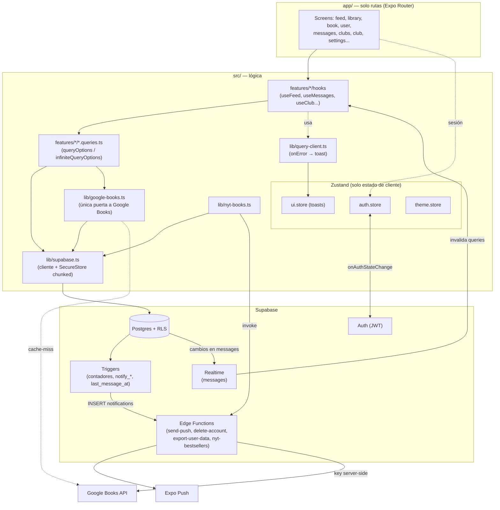
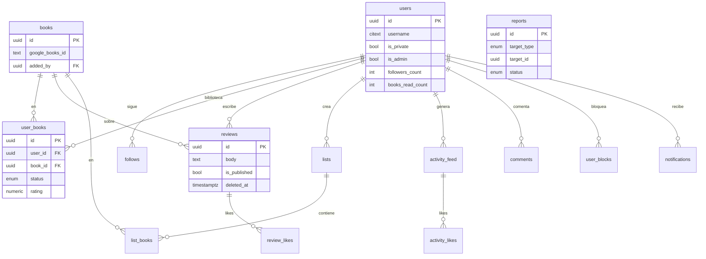
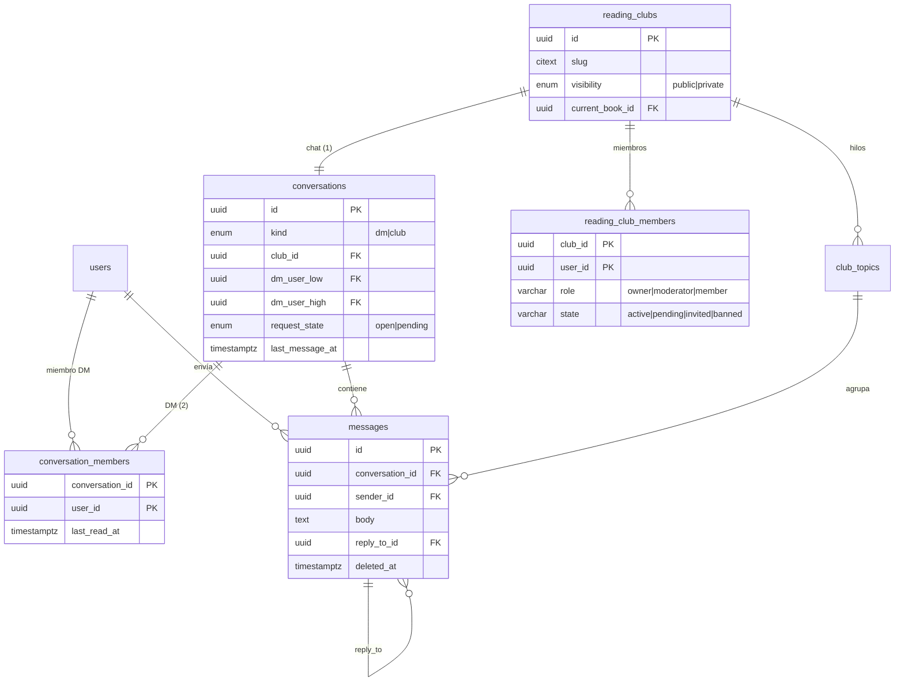
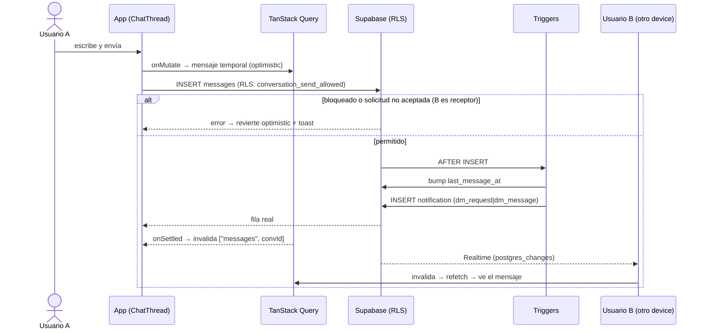
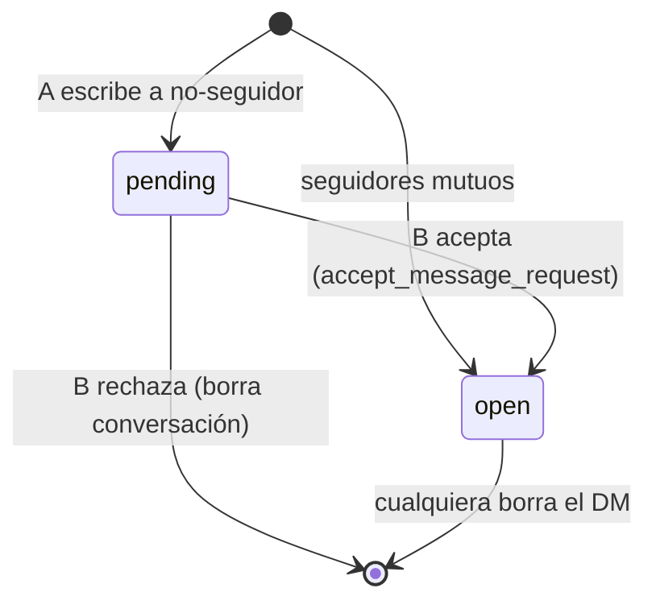
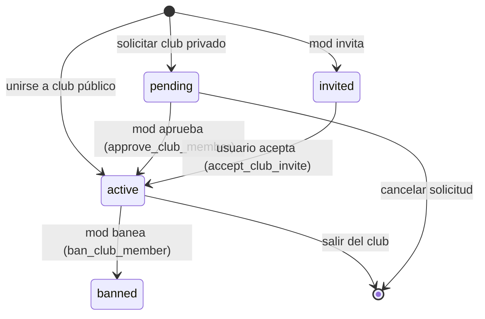

# Diagramas — Lexa Reads

> Diagramas en **Mermaid** (se renderizan en GitHub y VS Code con la extensión
> Markdown Preview Mermaid). Fuente única de la vista de alto nivel del sistema.
> Detalle de producto/DB → `STACK.md` · mensajería → `clubs-y-chat.md`.

---

## 1. Arquitectura y flujo de datos

Regla dura (CLAUDE.md): `app/` solo rutas; la lógica vive en `src/`; el estado de
servidor es TanStack Query y el de cliente es Zustand. Toda escritura pasa por RLS.

---

## 2. Esquema de base de datos (ER)

Dividido en **núcleo social** y **mensajería** para legibilidad; comparten `users`.
Solo columnas clave. Todas las tablas tienen RLS; `*_count` los mantienen triggers.

### 2.1 Núcleo social

### 2.2 Mensajería (clubes + DMs)

---

## 3. Secuencia — enviar un DM (con solicitud de mensaje + realtime)

> La puerta de solicitud: si A y B **no** son seguidores mutuos, `request_state='pending'`
> y B ve el hilo en *Solicitudes*; B solo puede responder tras `accept_message_request`.

---

## 4. Diagramas de estado

### 4.1 Solicitud de DM

### 4.2 Membresía de club

